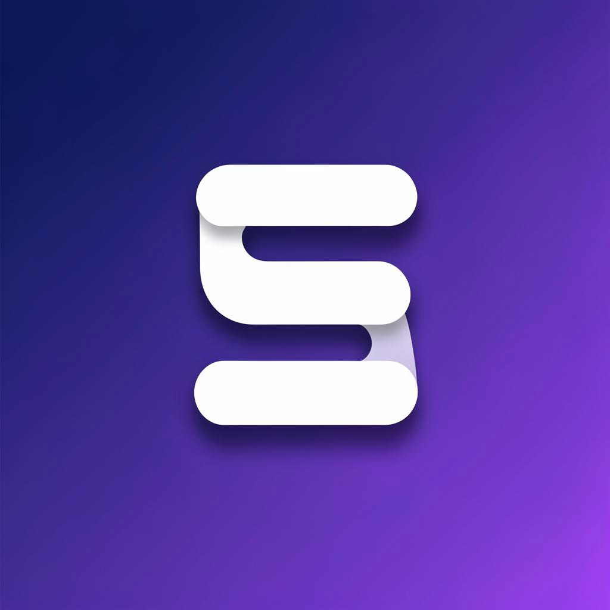

<p align="center">
  
</p>

<h1 align="center">SuperStore</h1>

<p align="center">
  <em>An untethered, community-driven sideloading app store for iOS.</em><br>
  Built on <a href="https://github.com/SideStore/SideStore">SideStore</a>, which is itself a fork of
  <a href="https://github.com/rileytestut/AltStore">AltStore</a>.
</p>

<p align="center">
  <a href="https://github.com/izzv/SuperStore/actions/workflows/verify.yml"></a>
  <a href="./LICENSE"></a>
  
  
  <a href="https://github.com/izzv/SuperStore/commits/develop"></a>
  <a href="https://izzv.github.io/SuperStore/"></a>
</p>

> **SuperStore is a work in progress.** Nothing has been released from this fork yet: it builds (CI compiles it on every push to `develop`), but it has not been signed, installed or tested on a device under the SuperStore name.

---

## What it does

SuperStore is a normal, sandboxed iOS app that sideloads other apps using nothing but your Apple ID. It signs them with your personal development certificate, installs them over a loopback tunnel provided by a VPN, and re-signs them before Apple's seven-day development window expires.

- **No AltServer, no computer, no jailbreak.**
- **Your own certificate** — apps are signed on-device.
- **Background refresh** — apps are re-signed so they keep opening.

## What this fork changes

- **Anisette server failover.** A dead or misbehaving Anisette server used to dump its raw HTML error page into the sign-in alert. SuperStore now tries the next configured server instead, and only reports a failure once every one has failed.
- **Sign-in errors that explain themselves.** Apple's `-80046`, `-80045` and `-22411` come with a plain-language cause and a suggested fix rather than a bare code.
- **Independent branding.** New name, icon set and About screen. Contact and social links live in `AppConstants.Brand` so they can be filled in one place — an unset value hides the control instead of shipping a dead link.

Everything else — sources, installation, refresh, backups — is inherited from SideStore.

## Requirements

- macOS with Xcode 15 or newer to build
- iOS 14 or newer on the device
- [LocalDevVPN](https://github.com/jkcoxson/LocalDevVPN) installed on the device, which provides the tunnel on-device installation needs

## Building

The app builds unsigned for the arm64 device slice, which needs no certificate, no provisioning profile and no attached device:

```sh
xcodebuild build \
  -project AltStore.xcodeproj \
  -scheme SideStore \
  -config Debug \
  -destination 'generic/platform=iOS' \
  CODE_SIGNING_ALLOWED=NO
```

That is exactly what CI runs (`.github/workflows/verify.yml`) on a GitHub-hosted macOS runner.

Do **not** target the simulator: the bundled `minimuxer` and `idevice` libraries ship only an arm64 slice, so `generic/platform=iOS Simulator` fails at link time with undefined symbols.

For signing, provisioning and running on a device, see [CONTRIBUTING.md](./CONTRIBUTING.md).

## How it fits together

| Piece | Role |
| --- | --- |
| `AltStore/`, `SideStore/` | The app itself: sources, app IDs, signing, installation, refresh |
| [SideSign](Dependencies/SideSign) | Apple Developer Services and Anisette client |
| [minimuxer](https://github.com/jkcoxson/minimuxer) | Lockdown muxer that runs inside the iOS sandbox |
| [EM Proxy](https://github.com/jkcoxson/em_proxy) | The loopback tunnel that makes on-device installation possible |

## Contributing

Build instructions, code signing setup and project conventions are in [CONTRIBUTING.md](./CONTRIBUTING.md).

## Licensing

AGPL-3.0. SuperStore is a fork of SideStore, which is a fork of AltStore; both are AGPL-3.0, and the original copyright notices are preserved in [LICENSE](./LICENSE).
